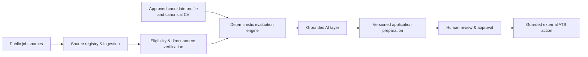

# AI Job Hunter & Application Agent

An evidence-grounded, human-in-the-loop AI agent for discovering, evaluating, and preparing job applications.

## Overview

Job searching is fragmented across employer career sites and public applicant-tracking systems. Generic AI writing tools can make an equally serious mistake: turning a job requirement into an unsupported claim about a candidate.

This project brings those steps into one local workflow. It discovers public vacancies, filters and verifies opportunities, evaluates fit against an approved candidate profile, and prepares job-specific materials. Deterministic rules decide eligibility, scoring, and safety boundaries; AI is used for structured extraction and grounded writing. A person remains in control of profile changes, sensitive answers, and external submission.

## Product workflow

`Discover → Filter → Verify → Evaluate → Tailor → Prepare → Review`

| Stage | What it does |
| --- | --- |
| Discover | Collects vacancies from configured public employer ATS sources and approved fallback sources. |
| Filter | Applies configured location, role-family, seniority, and eligibility rules before spending effort on a role. |
| Verify | Prefers a live direct employer or ATS vacancy over an aggregator record where a direct source is available. |
| Evaluate | Produces a deterministic match assessment from the job requirements and approved active candidate evidence. |
| Tailor | Uses AI only to turn selected supported evidence into job-specific, candidate-facing material. |
| Prepare | Creates versioned application materials and records the evidence used. |
| Review | Keeps human decisions, legal/privacy consent, CAPTCHAs, authentication, and final external submission explicit. |

## Demo

The built-in **Demo** page is a read-only recruiter walkthrough of the persisted discovery funnel, opportunity journey, requirement-to-evidence mapping, and human approval boundaries.

Portfolio screenshots are intentionally not committed with local runtime data. To add sanitized screenshots after cloning, capture these three views from the Demo page at desktop width and place them in [`docs/assets/`](docs/assets/README.md):

1. `pipeline-and-opportunity.png` — the live funnel and selected opportunity.
2. `requirement-evidence-mapping.png` — the requirement-to-evidence table.
3. `trust-and-human-review.png` — the safety, architecture, and final human-control section.

Do not include contact details, CV text, application answers, URLs containing personal identifiers, browser UI, or API credentials in screenshots.

## What makes it different

- **Direct-source first:** public ATS listings can be resolved to the employer’s own application destination before they enter the active queue.
- **Deterministic screening:** location, seniority, role-family, and explicit eligibility rules are not left to a free-form model judgement.
- **Evidence, not résumé improvisation:** candidate claims are drawn from approved active profile facts with source provenance.
- **Grounded writing:** generated material selects relevant evidence for the role; unsupported requirements remain visible gaps instead of becoming invented experience.
- **Freshness awareness:** canonical CV and approved-profile changes make dependent opportunity evaluations visibly stale until re-evaluated.
- **Human control:** sensitive questions, privacy/legal consent, CAPTCHA, authentication, and final submission remain explicit human checkpoints.
- **Persistent audit trail:** job, evaluation, material-version, and application-workflow history is retained locally.

## Example grounded evaluation

The Demo uses a persisted **Foodbank Queensland — Business Intelligence Analyst** opportunity to illustrate how a requirement is mapped to approved evidence rather than treated as a prompt for free-form claims.

| Job requirement | Candidate evidence | Result |
| --- | --- | --- |
| Power BI | AdventureWorks Sales Analytics Dashboard and an approved Power BI capability | Matched |
| SQL | Approved SQL evidence | Matched |
| Excel | Approved Excel evidence | Matched |

This table is intentionally narrow: it shows only evidence already approved in the local candidate profile. A job-description term alone is never evidence that the candidate has performed that work.

## Architecture



The architecture is deliberately hybrid:

- Deterministic services handle eligibility, deduplication, scoring, workflow state, and safety policy.
- The LLM is used for structured extraction, requirement/evidence matching assistance, and writing constrained to selected approved evidence.
- SQLite stores local workflow and provenance history; it is runtime data and is not part of the public repository.

## Tech stack

- **Python 3.11+** application and service layer
- **Streamlit** recruiter and operator interface
- **SQLite** local persistence and workflow history
- **Pydantic**-based domain modelling and validation
- **OpenAI API** integration for structured extraction and grounded generation when configured
- **HTTPX** public-source and ATS HTTP access
- **Playwright** guarded browser execution for supported ATS flows
- **pypdf** and **python-docx** CV text extraction
- **pytest** and **Ruff** for automated verification and linting

## Safety and grounding

- Candidate-facing claims must be supported by approved, active candidate facts.
- A requirement in a job description cannot become a candidate fact or an experience claim.
- Missing skills and other unsupported requirements remain explicit gaps.
- CV/profile changes make old opportunity evaluations stale; re-evaluation is an explicit action that preserves history.
- Candidate facts, saved answers, credentials, cookies, CAPTCHAs, and consent are not inferred.
- External submission requires a separate, explicit final confirmation and verified platform success evidence.

## Testing

The repository includes behavioural tests for discovery, deduplication, scoring, profile/CV freshness, grounding, application workflow states, and provider-specific boundaries.

Run the current suite locally:

```bash
pytest -q
ruff check .
python3 -m compileall -q src app
git diff --check
```

## Run locally

Requirements: Python 3.11 or newer and a local virtual environment.

```bash
git clone <your-repository-url>
cd AI-Job-Application-Agent
python3 -m venv .venv
source .venv/bin/activate
python -m pip install --upgrade pip
python -m pip install -e '.[dev]'
cp .env.example .env
streamlit run app/Home.py
```

Edit `.env` locally only when a feature needs an API credential. The application works with local SQLite runtime data at the configurable `DATABASE_PATH`; do not commit that database, candidate documents, generated materials, logs, or browser profile.

## Project status

This is a portfolio and personal AI-automation project, not a production job-board platform. Public-source coverage is bounded by configured, compliant providers and direct-source resolution. ATS execution is intentionally guarded and assisted where a provider, login, consent step, CAPTCHA, or form cannot be safely validated. It does not claim universal or unattended autonomous submission.

## Repository privacy

Local candidate documents, SQLite records, generated application materials, logs, browser/session state, and `.env` credentials are excluded from version control. See [`.gitignore`](.gitignore) and [`.env.example`](.env.example) before publishing a fork.
